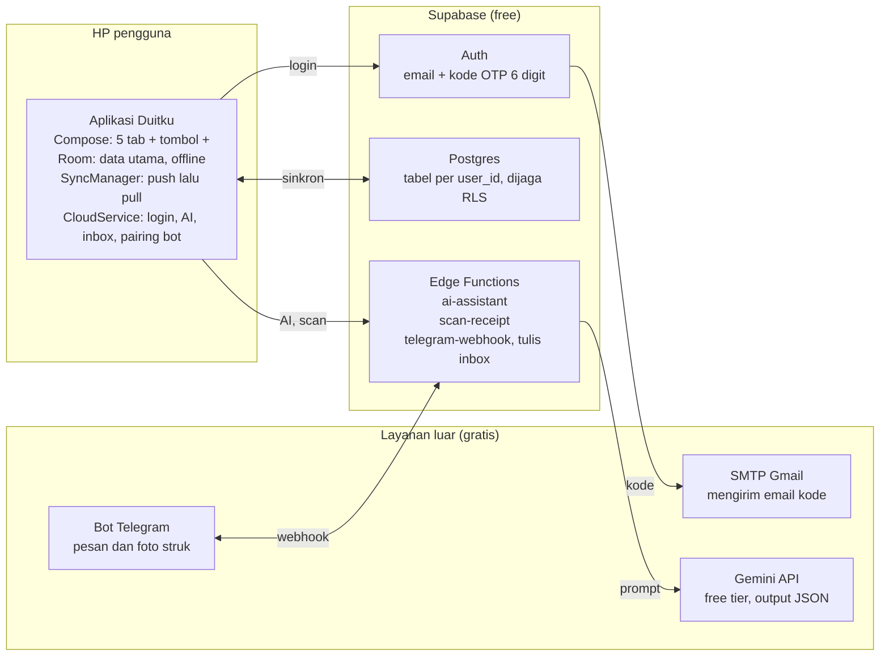

# PRD Duitku

Diperbarui: 20 Oktober 2026 · Versi dokumen: 1.0

## Ringkasan

Duitku adalah aplikasi Android pencatat keuangan pribadi dan usaha kecil yang bekerja offline lebih dulu, dengan AI dan bot Telegram sebagai jalan pintas mencatat. Semua fitur terbuka tanpa langganan, dan seluruh layanan cloud memakai paket gratis karena aplikasi ini untuk pemakaian pribadi.

**Visi:** mencatat uang semudah mengirim chat, dan memahami ke mana uang pergi dalam satu kali lihat.

**Tujuan versi 1.0:**

1. Mencatat transaksi dalam 3 ketukan atau 1 pesan chat.
2. Saldo setiap dompet selalu benar, termasuk transfer dan penyesuaian.
3. Data aman: tetap ada saat offline, tercadang ke cloud milik sendiri, dan bisa dipulihkan di HP baru.
4. Insight yang bisa ditindaklanjuti: anggaran, tren, dan catatan otomatis.
5. Biaya operasional Rp 0 per bulan (Supabase free, Gemini free tier, Telegram).

## Latar belakang

Duitku dibuat ulang dari nol dengan aplikasi Catat-in sebagai referensi fitur, karena fitur terbaik Catat-in dikunci di paket Pro dan datanya tersimpan di server pihak lain. Analisa APK Catat-in (Kotlin, Compose, Room, Supabase, Gemini/AI, ML Kit) menghasilkan 25 fitur yang menjadi dasar dokumen ini.

Masalah yang diselesaikan:

- **Fitur terkunci:** di Catat-in, dompet dibatasi 3, riwayat dan laporan lama dibatasi, ekspor PDF/Excel serta scan struk dan AI berkuota. Di Duitku semuanya terbuka.
- **Kepemilikan data:** data Duitku ada di HP dan di project Supabase milik pengguna sendiri, bukan di server pihak ketiga.
- **Mencatat itu membosankan:** pengguna berhenti mencatat bila butuh banyak ketukan. Duitku menyediakan form 3 ketukan, asisten chat, scan struk, bot Telegram, dan (rencana) auto-import notifikasi bank.

Kode, nama, logo, dan teks Duitku ditulis sendiri; tidak ada kode atau aset Catat-in yang disalin, dan backend Catat-in tidak dipakai.

## Pengguna

Pengguna utama adalah pemilik aplikasi sendiri; satu akun bisa memegang beberapa profil keuangan (pribadi dan usaha) yang terpisah datanya.

| Persona | Kebutuhan utama | Fitur kunci |
| --- | --- | --- |
| Pribadi: karyawan dengan beberapa rekening dan e-wallet | Tahu saldo tiap dompet, sisa uang sampai gajian, ke mana uang habis | Dompet & transfer, anggaran, Insight, auto-import notifikasi |
| Usaha kecil (UMKM): pemilik warung atau jasa | Pisahkan uang usaha dari pribadi, pantau arus kas harian | Profil Usaha dengan kategori bawaan usaha, laporan per periode, ekspor |
| Pencatat sibuk | Mencatat tanpa membuka form panjang | Tombol + (tahan = langsung catat), asisten chat, bot Telegram, scan struk |

Bahasa antarmuka: Indonesia, mata uang Rupiah, zona waktu Asia/Jakarta.

## Ruang lingkup

Versi 1.0 mencakup semua fitur yang dipetakan dari Catat-in, minus monetisasi, ditambah perbaikan kecil (sisa aman per hari, catatan otomatis).

**Termasuk:**

- Aplikasi Android (minSdk 26, targetSdk 36), offline-first.
- Pencatatan, dompet, kategori, multi-profil, riwayat, Insight, laporan & ekspor.
- Anggaran, target tabungan, tagihan rutin, kalkulator realita.
- Auto-import notifikasi bank/e-wallet, scan struk, input suara, asisten AI, bot Telegram, Inbox draf.
- Akun (email OTP), sinkron & backup ke Supabase, PIN & biometrik, widget (saldo & catat cepat; pengeluaran hari/minggu/bulan), pengingat, tema terang/gelap.

**Tidak termasuk:**

- Langganan Pro, iklan, pembelian dalam aplikasi, promo dari server.
- Versi iOS dan dashboard web (web hanya opsi lanjutan, belum dijadwalkan).
- Rilis publik di Play Store; aplikasi dipasang manual (APK) untuk pemakaian pribadi.
- Berbagi satu profil dengan orang lain secara real-time.
- Koneksi langsung ke API bank (data bank hanya dibaca dari notifikasi di HP).

## Arsitektur & teknologi

Duitku adalah aplikasi offline-first: Room di HP menyimpan data utama, sementara Supabase milik pengguna hanya dipakai untuk login, sinkron, dan sebagai perantara ke Gemini dan Telegram.

Aplikasi tetap jalan penuh bila cloud mati; kunci Gemini dan token bot hanya ada di Edge Functions, tidak pernah di HP.

| Lapisan | Teknologi |
| --- | --- |
| Aplikasi | Kotlin 2.1, Jetpack Compose + Material 3, Navigation Compose, DI manual (AppContainer) |
| Data lokal | Room 2.7 (skema v2, auto-migration), soft delete, updated_at untuk sinkron |
| Cloud | Supabase free: Auth (email OTP), Postgres + RLS, Edge Functions (Deno/TypeScript) |
| Klien cloud | supabase-kt 3.2 (Auth, Postgrest), Ktor 3.2.4 + OkHttp |
| AI | Gemini API free tier, output JSON terstruktur, model lewat secret `GEMINI_MODEL` |
| Bot | Telegram Bot API via webhook ke Edge Function |
| Build | AGP 8.11, Gradle 8.13, minSdk 26, targetSdk 36, R8 untuk release |

## Fitur: pencatatan inti

Pencatatan inti sudah dibuat dan berjalan sepenuhnya offline; saldo dompet selalu dihitung dari transaksi, tidak disimpan terpisah. Status di tabel fitur: **Dibuat** = kode ada dan terkompilasi (uji di HP menyusul), **Rencana** = belum dibuat, dengan fasenya.

| ID | Fitur | Kebutuhan | Status |
| --- | --- | --- | --- |
| P-01 | Catat transaksi | Pengeluaran/pemasukan dengan nominal, kategori, dompet, tanggal, catatan. Simpan ≤ 3 ketukan: nominal → kategori → Simpan. Dompet terakhir dan tanggal hari ini jadi bawaan | Dibuat |
| P-02 | Kategori favorit di depan | Grid kategori diurutkan dari yang paling sering dipakai | Dibuat |
| P-03 | Ubah & hapus | Semua transaksi bisa diubah; hapus memunculkan snackbar Urungkan, bukan dialog | Dibuat |
| P-04 | Transfer antar dompet | Dua transaksi berpasangan (keluar & masuk) dengan link id sama; tidak dihitung sebagai pemasukan/pengeluaran; hapus satu sisi = hapus keduanya | Dibuat |
| P-05 | Dompet | Tak terbatas; ikon, warna, saldo awal; Dompet Utama tidak bisa dihapus; hapus dompet menghapus transaksinya | Dibuat |
| P-06 | Penyesuaian saldo | Masukkan saldo sebenarnya; selisih dicatat sebagai penyesuaian di luar laporan | Dibuat |
| P-07 | Detail dompet | Saldo beranimasi, aksi Transfer/Sesuaikan/Ubah, masuk/keluar per bulan, transaksi per hari | Dibuat |
| P-08 | Kategori | Bawaan per jenis profil (17 pribadi, 14 usaha) + kustom dengan ikon & warna; hapus tidak merusak riwayat | Dibuat |
| P-09 | Multi-profil | Profil Pribadi/Usaha terpisah, masing-masing punya dompet & kategori bawaan; ganti profil dari Lainnya | Dibuat |
| P-10 | Riwayat | Per bulan, filter jenis/dompet/kategori, cari catatan/kategori/nominal, dikelompokkan per hari dengan total harian | Dibuat |
| P-11 | Gestur | Geser kiri = hapus (Urungkan), geser kanan = ubah | Dibuat |
| P-12 | Lampiran foto struk | Simpan foto struk bersama transaksi | Dibuat |

## Fitur: analisa

Beranda, Insight, proyeksi, dan ekspor CSV/PDF sudah dibuat. Semua angka analisa mengabaikan transfer dan penyesuaian saldo.

| ID | Fitur | Kebutuhan | Status |
| --- | --- | --- | --- |
| A-01 | Beranda | Header: pengeluaran bulan ini (beranimasi), saldo total & jumlah dompet, 3 statistik (rata-rata/hari, jumlah transaksi, pengeluaran terbesar). Ganti bulan dengan panah atau geser | Dibuat |
| A-02 | Kartu dompet | Baris kartu dompet yang bisa digeser; ketuk = detail dompet | Dibuat |
| A-03 | Grafik tren | Pengeluaran harian; ketuk titik untuk melihat nominal hari itu | Dibuat |
| A-04 | Kategori teratas | 4 kategori terbesar dengan porsi dari total; ketuk = riwayat kategori itu | Dibuat |
| A-05 | Insight per periode | Bulan, kuartal, tahun; bebas digeser ke periode lama; persentase naik/turun dibanding periode sebelumnya | Dibuat |
| A-06 | Rincian kategori | Bar per kategori, ketuk untuk melihat transaksinya | Dibuat |
| A-07 | Catatan otomatis | Aturan sederhana: rasio tabungan (target 20%), kategori ≥ 30% pengeluaran, ≥ 5 transaksi < Rp 20rb, ≥ 3 pengeluaran di atas jam 21.00 | Dibuat |
| A-08 | Proyeksi | Perkiraan pengeluaran sampai akhir bulan dan setahun dari laju saat ini | Dibuat |
| A-09 | Sisa aman per hari | Sisa anggaran dibagi sisa hari sampai akhir periode | Dibuat |
| A-10 | Ekspor laporan | PDF (cetak/bagikan) dan Excel/CSV per periode | Dibuat |

## Fitur: perencanaan

Anggaran per kategori, target tabungan, deteksi tagihan rutin, dan kalkulator realita sudah dibuat.

| ID | Fitur | Kebutuhan | Status |
| --- | --- | --- | --- |
| R-01 | Anggaran | Batas per satu atau beberapa kategori; periode bulanan/mingguan/kustom; progres, sisa, dan label "Hampir habis" di ≥ 90% | Dibuat |
| R-02 | Peringatan anggaran | Notifikasi dan getar halus saat anggaran ≥ 90% dan saat terlampaui | Dibuat |
| R-03 | Target tabungan | Nama, nominal target, tanggal target, ikon, warna; log setor/tarik; status aktif/tercapai/arsip | Dibuat |
| R-04 | Tagihan rutin | Deteksi pengeluaran berulang di tanggal serupa tiap bulan; pengingat sebelum jatuh tempo | Dibuat |
| R-05 | Kalkulator realita | 5 alat: realita gaji (per jam/detik), realita umur, hutang tidur, biaya rokok, jebakan langganan; kartu hasil yang bisa dibagikan | Dibuat |

## Fitur: otomatisasi & AI

Semua fitur otomatisasi sudah dibuat: asisten AI, scan struk, bot Telegram, Inbox, auto-import notifikasi, dan input suara (offline). Semua hasil otomatis masuk sebagai **draf** yang ditinjau dulu, tidak pernah langsung jadi catatan.

| ID | Fitur | Kebutuhan | Status |
| --- | --- | --- | --- |
| O-01 | Lembar tombol + | Pengeluaran/Pemasukan/Transfer + Scan struk, Tanya asisten, Suara; tahan tombol + = langsung form pengeluaran | Dibuat |
| O-02 | Asisten AI | Chat bahasa sehari-hari → draf transaksi (maks 10 per pesan) atau jawaban analisa dari ringkasan bulan ini & bulan lalu; simpan/ubah per draf; menolak topik di luar keuangan | Dibuat |
| O-03 | Scan struk | Kamera atau galeri; foto diperkecil (sisi ≤ 1.600 px, JPEG 85%); Gemini membaca merchant, barang, total, tanggal, kategori; hasil mengisi form catat | Dibuat |
| O-04 | Bot Telegram | Pairing kode 6 digit (berlaku 10 menit, tautan t.me langsung); pesan teks atau foto struk → draf di Inbox; perintah /status, /putus, /bantuan; hanya chat pribadi | Dibuat |
| O-05 | Inbox draf | Daftar draf dengan teks asli, hasil bacaan, label Yakin/Perlu cek (keyakinan ≥ 0,6 dan berkategori); Simpan, Ubah, Buang (Urungkan); simpan semua yang yakin; lonceng berbadge di Beranda | Dibuat |
| O-06 | Auto-import notifikasi | NotificationListenerService membaca notifikasi BCA, BRImo, Livin', wondr, BSI, GoPay, DANA, ShopeePay, OVO, LinkAja, Jenius, dll.; parser per sumber dengan unit test; dedupe fingerprint; draf ke Inbox | Dibuat |
| O-07 | Catat dengan suara | Pengenal suara Android → teks → parser yang sama dengan asisten | Dibuat |
| O-08 | Batas pemakaian AI | Maks permintaan AI per akun per hari (bawaan 50, secret `AI_DAILY_LIMIT`); pesan ramah saat kuota Gemini habis (429) | Dibuat |

## Akun, sinkron & keamanan

Login email OTP, sinkron dua arah, kunci PIN/biometrik, dan backup/restore file sudah dibuat. Aplikasi tetap bisa dipakai penuh tanpa akun.

| ID | Fitur | Kebutuhan | Status |
| --- | --- | --- | --- |
| K-01 | Login email OTP | Kode 6 digit via SMTP Gmail milik pengguna; kirim ulang setelah 60 detik; keluar akun tidak menghapus data di HP | Dibuat |
| K-02 | Sinkron dua arah | Push baris lokal yang berubah, lalu pull baris cloud sejak cursor; otomatis 4 detik setelah perubahan, saat login, dan manual; perubahan lokal saat sinkron tidak ditimpa | Dibuat |
| K-03 | Pulihkan di HP baru | Login di HP baru menarik semua data dari cloud | Dibuat |
| K-04 | PIN & biometrik | PIN 6 digit, buka dengan sidik jari/wajah setelah PIN dibuat, kunci saat aplikasi dibuka ulang | Dibuat |
| K-05 | Backup file | Ekspor/impor JSON lengkap ke penyimpanan HP, tanpa akun | Dibuat |
| K-06 | Login Google | Alternatif tanpa email (Credential Manager + Supabase) | Rencana (opsional) |

**Aturan keamanan & privasi:**

- Kunci rahasia (Gemini, token bot, secret webhook) hanya disimpan sebagai secrets Supabase; APK hanya berisi URL project, publishable key, dan username bot.
- Setiap tabel cloud dilindungi Row Level Security: pengguna hanya bisa membaca dan mengubah baris dengan `user_id` miliknya. Inbox draf hanya bisa dibuat oleh server.
- Webhook Telegram diverifikasi lewat header secret; fungsi AI mewajibkan JWT login.
- Sebelum AI pertama kali dipakai, ada layar persetujuan. Yang dikirim ke Gemini: pesan/foto, nama kategori & dompet, total bulan ini & bulan lalu. Saldo dompet dan catatan transaksi tidak dikirim.
- Gemini free tier dapat memakai data untuk meningkatkan layanannya; pengguna diminta tidak mengirim nomor rekening atau PIN.

## UX & desain

Desain v2 memakai gaya **soft neumorphism** yang bersih: kartu putih dengan bayangan lembut di atas latar krem, kartu dompet gelap ala kartu fisik, dan navigasi pill melayang. Panduan lengkapnya ada di [DESIGN.md](DESIGN.md).

| Tab | Isi |
| --- | --- |
| Beranda | Sapaan + avatar (buka Pengaturan) + lonceng Inbox, total saldo dengan tombol sembunyikan, slider kartu dompet, progres pengeluaran bulan ini vs batas, aksi cepat 2×2, riwayat per hari |
| Dompet | "Dompet Saya": slider kartu, aksi bulat Sesuaikan/Ubah/Riwayat/Transfer, arus bulan ini, transaksi per dompet, tambah/hapus dompet |
| + (tengah) | Lembar pilihan cara mencatat; tahan = langsung pengeluaran |
| Insight | Periode bulan/kuartal/tahun, perbandingan, rincian kategori, catatan otomatis, riwayat lengkap, ekspor |
| Rencana | Anggaran, tabungan, tagihan rutin, kalkulator realita |

Profil & Pengaturan (nama, profil keuangan, akun & sinkron, bot Telegram, kategori, batas bulanan, tema, sembunyikan saldo) dibuka dari avatar di Beranda.

**Prinsip interaksi:**

- Catat dalam 3 ketukan; dompet dan tanggal mengikuti pilihan terakhir.
- Hapus selalu bisa diurungkan (snackbar 4 detik); dialog konfirmasi hanya untuk hapus dompet, profil, dan keluar akun.
- Status kosong dengan ilustrasi garis dan petunjuk langkah berikutnya; fitur yang belum ada diberi label "Segera".
- Interaktif: count-up angka saldo, geser kartu dompet, geser baris transaksi, ketuk titik grafik, getar halus saat menyimpan dan menekan +.

**Identitas visual:**

- Nama **Duitku**, package `com.aamnnr.duitku`; ikon adaptif logo v3 (dompet dengan koin dan ayunan karamel) beserta versi monokrom.
- Palet: latar krem `#F8F6F3`, kartu putih `#FFFFFF`, espresso `#2A2421`, karamel `#C08A5B`, teks `#1C1C1E` / `#8E8E93`, garis `#E5E5EA`; pemasukan `#3F7D58`, pengeluaran `#B4533A`, transfer `#4E6E8E`. Mode gelap: latar `#121212`, kartu `#1E1E1E`, aksi karamel.
- Tipografi Plus Jakarta Sans (variable font, dibundel), sudut 16–26 dp.
- Tema bisa dipilih: ikuti sistem, terang, gelap.

## Model data

Tabel lokal (Room, versi skema 2) dan cloud (Postgres) memakai kolom yang sama agar sinkron cukup menyalin baris: id UUID teks, nominal bigint rupiah, tanggal epoch millis, hapus = soft delete.

| Tabel | Lokal | Cloud | Kolom penting |
| --- | --- | --- | --- |
| profiles / fin_profiles | ya | ya | id, name, type (PERSONAL/BUSINESS), created_at |
| wallets | ya | ya | id, profile_id, name, icon, color, is_default, sort_order, is_deleted |
| categories | ya | ya | id, profile_id, name, type (INCOME/EXPENSE), icon, color, is_default, is_deleted |
| transactions | ya | ya | id, profile_id, type, amount, category_id, wallet_id, note, transaction_date, is_adjustment, linked_transfer_id, transfer_type (OUT/IN), is_deleted |
| settings | ya | – | key, value (profil aktif, tema, dompet terakhir, persetujuan AI, posisi sinkron) |
| inbox_drafts | – | ya | id, source (telegram/notification/assistant), raw_text, parsed (JSON draf), status (PENDING/IMPORTED/DISCARDED) |
| telegram_links | – | ya | user_id, chat_id, username, profile_id |
| telegram_pairing_codes | – | ya | code (6 digit), user_id, profile_id, expires_at |
| ai_usage | – | ya | user_id, day (Asia/Jakarta), count |
| budgets, saving_goals, saving_logs, parsed_notifications | Fase 2–3 | Fase 2–3 | mengikuti pola yang sama |

Kolom sinkron: lokal punya `updated_at` (epoch millis, 0 = tidak ada perubahan lokal); cloud punya `user_id` (default `auth.uid()`) dan `updated_at` (waktu server, dipakai sebagai cursor pull). Saldo dompet = jumlah pemasukan dikurangi pengeluaran di dompet itu, tidak pernah disimpan.

## Kebutuhan non-fungsional

Aplikasi harus terasa instan saat offline dan tidak pernah kehilangan data, dengan biaya operasional Rp 0.

| Aspek | Target |
| --- | --- |
| Offline | Semua fitur pencatatan, analisa, dan perencanaan jalan tanpa internet |
| Kecepatan | Buka aplikasi ke Beranda < 1,5 detik; simpan transaksi < 200 ms; jawaban AI < 10 detik |
| Integritas data | Saldo = hasil hitung transaksi; transfer & penyesuaian ditulis dalam satu transaksi database; migrasi Room tanpa kehilangan data |
| Sinkron | Tidak ada data hilang saat sinkron gagal; dicoba lagi otomatis pada perubahan berikutnya |
| Ukuran APK | Release dengan R8 ≤ 5 MB (saat ini 2,5 MB) |
| Perangkat | Android 8.0 (API 26) ke atas; tampilan HP potret, mode terang & gelap |
| Biaya | Supabase free, Gemini free tier, Telegram gratis; batas AI harian menjaga kuota |
| Bahasa | Antarmuka bahasa Indonesia, format Rupiah id-ID (Rp 1.250.000) |
| Kualitas kode | Kotlin + Compose, arsitektur data/domain/ui; unit test untuk format, validasi draf, parser notifikasi |

## Status & roadmap

Fondasi, desain, MVP offline, dan fitur AI & online sudah dibuat; backend Supabase live, sedangkan aplikasi versi online sedang diuji di HP.

```mermaid
flowchart LR
    F0["Fase 0 · selesai<br/><b>Setup</b><br/>Kotlin, Compose, Room"] --> F05["Fase 0.5 · selesai<br/><b>Desain</b><br/>Nama, ikon, palet Kopi"]
    F05 --> F1["Fase 1 · selesai<br/><b>MVP offline</b><br/>Transaksi, dompet, kategori, Insight"]
    F1 --> F5["Fase 5 · diuji di HP<br/><b>AI dan online</b><br/>Login, sinkron, asisten, scan, bot, inbox"]
    F5 --> F2["Fase 2 · berikutnya<br/><b>Perencanaan</b><br/>Anggaran, tabungan, ekspor PDF, backup"]
    F2 --> F3["Fase 3<br/><b>Auto-import</b><br/>Notifikasi bank & e-wallet ke Inbox"]
    F3 --> F4["Fase 4<br/><b>Kenyamanan</b><br/>PIN, widget, pengingat, suara, kalkulator"]
    F4 --> R1{{"Gerbang rilis<br/><b>Duitku 1.0</b><br/>Keystore release, semua fitur lolos uji"}}
    classDef now stroke-width:3px
    class F5 now
```

Fase 5 dikerjakan lebih dulu atas permintaan. Urutan berikutnya: perencanaan (anggaran, tabungan, laporan) lalu auto-import notifikasi, sebelum fitur kenyamanan dan rilis 1.0.

**Langkah terdekat:**

- [ ] Uji di HP: login OTP, sinkron, asisten, scan struk, pairing bot, Inbox
- [ ] Siapkan keystore release sendiri dan build release bertanda tangan
- [ ] Mulai Fase 2: anggaran, target tabungan, ekspor PDF/CSV, backup file
- [ ] Kumpulkan contoh teks notifikasi bank/e-wallet untuk parser Fase 3

## Metrik keberhasilan

Karena pemakaian pribadi, keberhasilan diukur dari kebiasaan mencatat dan ketepatan data, bukan jumlah pengguna.

| Metrik | Target | Cara ukur |
| --- | --- | --- |
| Hari mencatat | ≥ 25 dari 30 hari | Hari dengan ≥ 1 transaksi di riwayat |
| Waktu mencatat manual | ≤ 10 detik per transaksi | Uji langsung dengan stopwatch |
| Selisih saldo | Rp 0 dibanding saldo bank/e-wallet di akhir bulan | Jumlah penyesuaian saldo per bulan |
| Draf otomatis diterima | ≥ 80% draf bot/scan/notifikasi disimpan tanpa diubah | Status IMPORTED vs DISCARDED di inbox_drafts |
| Sinkron | 0 kejadian data hilang | Bandingkan jumlah baris lokal vs cloud |
| Biaya bulanan | Rp 0 | Tagihan Supabase & Google AI Studio |

## Risiko & pertanyaan terbuka

Risiko terbesar ada pada batasan paket gratis dan format notifikasi bank yang bisa berubah; keduanya punya cadangan yang membuat pencatatan manual tetap jalan.

| Risiko | Dampak | Mitigasi |
| --- | --- | --- |
| Supabase free dijeda setelah ± 7 hari tanpa aktivitas | Bot dan sinkron berhenti | Aplikasi tetap offline; aktifkan lagi dari dashboard; sinkron rutin menjaga project tetap aktif |
| Kuota Gemini free tier habis atau model berganti | Asisten, scan, bot gagal sementara | Batas harian, pesan ramah, nama model lewat secret `GEMINI_MODEL` |
| Privasi data di Gemini free tier | Data dipakai Google | Layar persetujuan, kirim data seperlunya, tanpa saldo dan nomor rekening |
| Format notifikasi bank berubah | Auto-import salah baca | Parser per sumber dengan unit test, semua hasil berupa draf yang ditinjau |
| Nama Duitku dipakai payment gateway duitku.com | Bentrok merek bila dipublikasikan | Aman untuk pemakaian pribadi; tinjau ulang nama sebelum rilis publik |
| Rilis masih memakai kunci debug | Update gagal bila APK dibangun di laptop lain | Siapkan keystore release sendiri (`keystore.properties` di luar git) |
| Sinkron last-write-wins | Perubahan dari dua HP pada baris sama bisa tertimpa | Cukup untuk 1–2 HP; catat konflik bila pemakaian multi-HP meningkat |

**Pertanyaan terbuka:**

- [ ] Login Google perlu ditambahkan, atau email OTP sudah cukup?
- [ ] Daftar bank/e-wallet prioritas untuk auto-import (butuh contoh teks notifikasi asli dari HP)?
- [ ] Dashboard web diperlukan, atau bot Telegram sudah cukup sebagai akses di luar HP?
